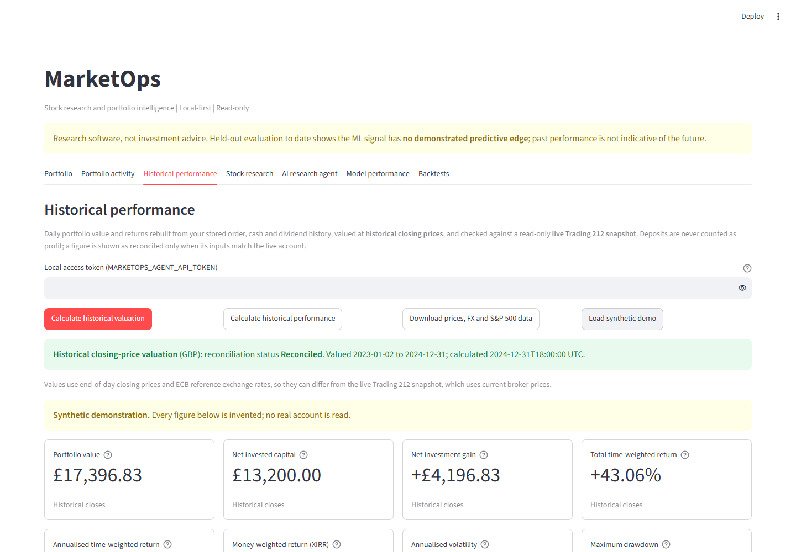
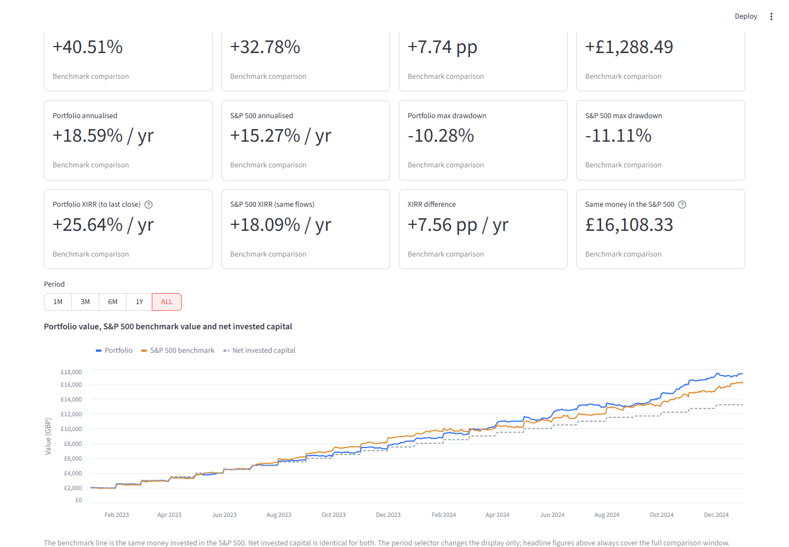
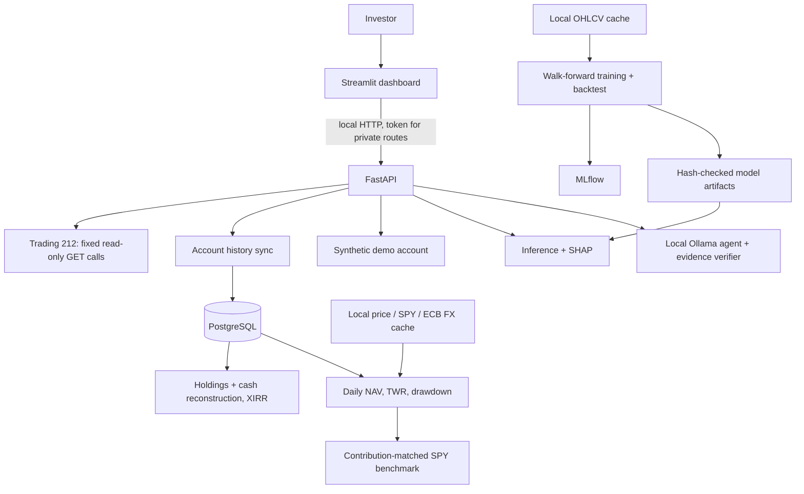

# MarketOps

A local, privacy-first stock research and portfolio analytics application. It reconstructs a brokerage
account's history, values it daily in GBP, compares it with a contribution-matched S&P 500 benchmark, and
pairs that with a leakage-guarded ML research pipeline and a local LLM research agent whose claims are
checked against tool evidence. It is a **research and engineering project, not investment advice.**

> **The ML classifier has no demonstrated predictive edge** (held-out ROC-AUC 0.496). It is included as an
> example of evaluating a model honestly, not as a trading strategy. See [ML results](#ai-and-ml-components).




*Screenshots use the built-in synthetic account only; no real data appears in this repository.*

## The problem

Retail investors see holdings and a headline P/L, but rarely a reconciled answer to "how has my money
performed, how does it compare with simply buying the index, and how risky was it?". Answering that
correctly needs verified cash flows, consistent currencies, dated prices and honest handling of missing
data. MarketOps works on that problem end to end. Guiding rules: fail closed rather than compute a wrong
number; never fabricate or silently substitute data; keep private brokerage data on the user's machine.

## Architecture



Stack: Python 3.13, FastAPI, Pydantic, SQLAlchemy, PostgreSQL, Streamlit + Altair, scikit-learn, XGBoost, SHAP,
MLflow, Ollama (local models only), Docker Compose, pytest, Ruff, strict Mypy, GitHub Actions. More detail:
[docs/architecture.md](docs/architecture.md).

## Portfolio reconstruction and benchmark methodology

1. **History.** Orders, cash transactions and dividends are read from Trading 212 (read-only) into PostgreSQL
   idempotently, with completeness auditing.
2. **Reconstruction.** Holdings and a cash ledger are replayed from executed fills and checked against the live
   broker snapshot. Every figure is gated: it is shown as reconciled only when its inputs match; otherwise it is
   partial, with blockers, or unavailable, with a reason.
3. **Valuation.** Daily GBP net asset value from unadjusted closing prices (dividends counted once, as cash) and ECB
   reference FX. Output: net invested capital, time-weighted return (TWR), volatility, drawdown, monthly/annual
   returns, and a money-weighted return (XIRR). Details: [docs/valuation.md](docs/valuation.md).
4. **Benchmark.** The same deposits and withdrawals are replayed into SPY (dividend-adjusted close as a total-return
   proxy, converted to GBP with same-date ECB rates) at the close of the same day, or the next trading day. Both
   sides are compared only on days with a portfolio value *and* a benchmark price, with the same flows, currency
   and end-of-day timing. Shown: values, TWR, annualised return, maximum drawdown, closing-price XIRR and the
   differences. If the data cannot support a like-for-like comparison, the exact reason is shown instead.
   Details and limitations: [docs/benchmark-design.md](docs/benchmark-design.md).

TWR removes the timing of your deposits (how the investments performed); XIRR is the yearly rate on your actual
dated flows (how your money performed). The dashboard explains both, and the benchmark XIRRs end at a closing
price rather than a live balance so they are comparable with each other.

## Medium-term research and paper journal

The **Stock research** tab includes a deterministic 2–12-week position research workflow, separate
from the existing five-session ML classifier. The technical screen checks a 20-session breakout,
50/200-session trend and prior-volume confirmation; stale data is refused. A fixed-rule historical
backtest executes entry and exit signals at the **next session's open**, applies 10 bps one-way
hypothetical costs, and compares with buy-and-hold over the identical window. It is not
walk-forward parameter optimisation or proof of predictive edge; the underlying current-stock
universe is survivorship-biased.

The risk scenario compares a hypothetical GBP loss budget with a position-concentration cap.
It can prefill an already loaded GBP portfolio snapshot, but never contacts Trading 212 by itself.
Missing/ambiguous ticker exposure must be entered by the user; stop distances are not guaranteed
execution prices.

The **Research journal** tab stores manual hypothetical ideas and outcomes in the local
PostgreSQL database. It is token-protected, preserves decision and recording dates and marks
backdated research retrospective. Gross hypothetical P/L excludes spreads, fees, tax and FX, and
**must not be represented as real or independently verified paper-trading fills**.

There is no current, licensed news-retrieval pipeline in this release. The local LLM agent can
research from its bounded existing tools; it must not invent recent headlines or claim live news.
For the detailed implemented-versus-unverified audit, see
[original scope audit](docs/original-scope-audit.md).

## AI and ML components

- **Research pipeline.** Target: positive 5-session forward return for 10 US large caps. Point-in-time features,
  purged expanding-window walk-forward CV (2010-2021), one held-out test period (2022+), logistic regression vs
  XGBoost, SHAP, drift and data-quality monitoring, MLflow tracking, hash/schema-checked model artifacts.
- **Measured result.** Held-out (n = 12,040, base rate 54.9 %): **ROC-AUC 0.496** (date-block bootstrap 95 %
  interval about 0.476 to 0.518); development AUC 0.514 did not hold out of sample; the model does not beat an
  always-up baseline on log-loss or Brier score. In the 2022+ backtest (10 bps costs, 5-session rebalance) it
  returned CAGR 14.4 % (Sharpe 0.92) against 17.3 % for equal-weight and 11.9 % for SPY, all inflated by survivorship
  bias. **There is no evidence the model predicts returns and it must not be used to trade.**
- **Backtest limits.** Today's large caps (survivorship bias), flat cost assumption, one history and one window.
  An earlier reporting-window error was found and fixed ([docs/technical-audit.md](docs/technical-audit.md)).

## LLM research agent

A local Ollama model (`qwen3.5:4b`) answers questions by calling an allowlisted set of bounded, schema-validated
tools (price summary, ML signal, model evaluation, backtest, SHAP, portfolio weights). There are no shell, network,
SQL, filesystem or order tools. Output is schema-constrained, and every claim must cite evidence; a rule-based
verifier rejects uncited claims, numbers not bound to the cited metric/subject/period/unit, comparisons not
computed by code, advice or certainty language, and any claim of predictive edge. Rejected claims are shown, not
hidden; failures fall back to a labelled template. Portfolio access is opt-in and weights-only. A 26-case
deterministic regression set (not an LLM quality score) gates the verifier ([docs/agent-evaluation.md](docs/agent-evaluation.md)).
Private portfolio data is never sent to an external LLM.

## Quantitative evaluation

Walk-forward validation, a single untouched test window, block-bootstrap intervals, baselines (always-up, momentum,
equal-weight, SPY) and an independent rebuild of the backtest from raw CSVs are documented in
[docs/status.md](docs/status.md). Valuation and benchmark maths are tested against independent plain-float
reference calculations (closed forms, hand-computed drawdowns, prefix/no-look-ahead and price-rescaling invariance).

## Security and privacy

- `.env`, market data, model artifacts, MLflow stores and logs are git-ignored; only `.env.example` is committed.
- Trading 212 access is two fixed read-only `GET` families (summary/positions and history pages). There is no code path
  for orders, transfers or writes. Live (real-money) access needs both `MARKETOPS_T212_ENVIRONMENT=live` and
  `MARKETOPS_T212_ALLOW_LIVE=true`. Use a key with read scopes only ([docs/trading212-setup.md](docs/trading212-setup.md)).
- Private routes need a local token (`X-MarketOps-Token`, constant-time compare, minimum length, **403 when unset**).
  The dashboard keeps the typed token in session memory only. Only the synthetic routes are public.
- Account identifiers are stored as hashes; keys and tokens are redacted from logs and errors; broker-backed agent
  questions are withheld from the audit table.
- Downloaded market data (prices, SPY, FX) stays in the local git-ignored cache and is never redistributed. Only public
  symbols and dates are sent to providers.
- Never post real portfolio screenshots or API output.

## Local installation

```
git clone https://github.com/PranayElligaram/marketops.git
cd marketops
cp .env.example .env        # set MARKETOPS_DB_PASSWORD to a unique local value
docker compose up --build -d --wait
```

Dashboard: `http://127.0.0.1:8503`. API docs: `http://127.0.0.1:8001/docs`.

For the research pipeline you download price data yourself (not redistributed here):

```
python -m marketops.data.cli ingest
python -m marketops.training.cli --mlflow
python -m marketops.backtest.run
```

Price data comes from an unofficial Yahoo chart endpoint for **personal research use only**; check its terms.

## Synthetic demonstration mode

No Trading 212 account or token is needed. Open the dashboard, go to **Historical performance** and press
**Load synthetic demo** for a complete invented account (two years of deposits, trades, a withdrawal, US holidays)
with the full benchmark comparison, served by the public `GET /performance/demo`. The **Portfolio** tab's
*Synthetic example* shows the live-snapshot view. Everything runs on generated data.

## Automated tests and CI

```
python -m venv .venv && pip install -c constraints.txt -e ".[dev,train,ui,tracking]"
pytest -q
ruff check . && ruff format --check . && mypy src api
```

Dependencies are pinned in `constraints.txt`. Tests use deterministic synthetic fixtures only (history parsing,
reconstruction, valuation, benchmark, ML, agent verifier, API authentication, Streamlit AppTest); PostgreSQL
integration tests run opt-in in Docker (`scripts/run_integration_tests.sh`). GitHub Actions runs Ruff, format check,
strict Mypy and pytest with no secrets, broker account or local services. The final recorded results are in
[docs/status.md](docs/status.md).

## Known limitations

- No demonstrated predictive skill; treat model output as research noise.
- The benchmark is SPY (an ETF proxy: ~0.09 % expense ratio, tracking error), assumes zero costs and taxes, mixes
  USD/GBP moves, and pairs same-date ECB and US closes. The portfolio holds a different risk mix, so a gap is not
  evidence of skill.
- Reconstruction cannot prove history reaches account opening; corporate actions are flagged, not applied; mergers,
  spin-offs and ticker changes are not interpreted (a renamed symbol needs a local override).
- Free personal-use price data with no second source; daily closes only.
- Live Trading 212 history endpoints need the `history:*` read scopes; real-response shapes were validated only
  against the OpenAPI schema and read-only live checks on one account.
- Local single-user design; token auth only; no hosted deployment.

## Licence

MIT. See [LICENSE](LICENSE).
