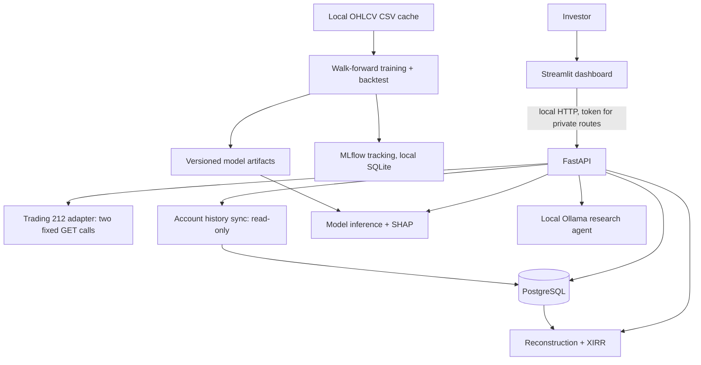

# MarketOps

A local, privacy-first stock research and portfolio analytics application. It combines a read-only
Trading 212 integration, a leakage-guarded ML research pipeline, a FastAPI service, a Streamlit
dashboard and a local LLM research agent. It is a **research and engineering project, not
investment advice and not production-ready.**

> **The ML model has no demonstrated predictive edge.** See [ML methodology and results](#ml-methodology-and-measured-results).

## Motivation

Retail investors see holdings and a headline P/L, but rarely a reconciled answer to "how has my
money actually performed, and how risky is it?". Answering that correctly needs verified cash flows,
consistent currencies and honest handling of missing data. MarketOps explores that problem end to end,
and also serves as a worked example of evaluating a forecasting model without fooling yourself.
Guiding rules: fail closed rather than compute a wrong number; never fabricate data; keep private
brokerage data on the user's machine.

## Architecture



## Technology stack

Python 3.13, FastAPI, Pydantic, SQLAlchemy, PostgreSQL, Streamlit, scikit-learn, XGBoost, SHAP,
MLflow, Ollama (local models only), Docker Compose, pytest, Ruff, strict Mypy, GitHub Actions.

## Implemented features

- **Market data:** validated, idempotent daily OHLCV cache for 10 US large caps plus SPY.
- **ML research:** point-in-time features, purged expanding-window walk-forward CV, one held-out test period,
  logistic regression vs XGBoost, SHAP, drift and data-quality monitoring, MLflow tracking.
- **Backtesting:** signals at close, fills at next open, flat 10 bps one-way costs; compared with momentum,
  equal-weight and SPY baselines.
- **Portfolio analytics:** concentration, cash, currency and reconciliation of summary vs positions.
- **Account history (read-only):** orders, cash transactions and dividends, stored idempotently in PostgreSQL
  with completeness auditing.
- **Performance reconstruction:** event-driven holdings and cash ledger from executed fills, reconciled to the
  broker snapshot, plus a money-weighted return (XIRR) that is refused when its preconditions fail.
- **Historical valuation:** daily GBP NAV from reconstructed holdings, cached public prices and ECB FX; net invested capital, time-weighted return, volatility, drawdown and period returns, each gated on reconciliation to the broker ([docs/valuation.md](docs/valuation.md)).
- **Research agent:** a local Ollama model that calls bounded tools; its claims are checked against tool evidence.
- **Security:** token-protected private routes, secret redaction, live-account double opt-in.

Exact verified numbers and change history are in [docs/status.md](docs/status.md).

## ML methodology and measured results

Target: whether the 5-session forward return is positive. Features are point-in-time; training uses purged
expanding-window walk-forward CV (2010-2021); the 2022+ period is evaluated once as a held-out test.

| Measure (held-out test, n = 12,040) | Result |
|---|---|
| Base rate of positive 5-session return | 54.9 % |
| ROC-AUC | 0.496 (date-block bootstrap 95 % interval about 0.476 to 0.518) |
| Walk-forward development AUC | 0.514, which did not hold out of sample |

The model does not beat an always-up baseline on log-loss or Brier score, and XGBoost did not beat logistic
regression. In the 2022+ backtest (10 bps costs, 5-session rebalance, risk-free rate 0) the model returned
a CAGR of 14.4 % (Sharpe 0.92), against 17.3 % (1.17) for equal-weight and 11.9 % (0.74) for SPY. **There is no
evidence the model predicts returns.**

## Backtest limitations and survivorship bias

- The universe is today's large caps, so every strategy, including the baselines, is inflated by survivorship bias.
- Costs are a flat assumption: no spread variation, market impact, taxes or FX costs; cash earns 0 %.
- Results come from a single history and a single held-out window; they are not forward-looking.
- An earlier reporting-window error was found and fixed during audit; see [docs/technical-audit.md](docs/technical-audit.md).

## Trading 212 read-only architecture

The client issues only fixed `GET` requests (account summary, positions, and history pages). There is no code
path for orders, transfers or any write. Live (real-money) access is refused unless both
`MARKETOPS_T212_ENVIRONMENT=live` and `MARKETOPS_T212_ALLOW_LIVE=true` are set. Create the API key in Trading 212 with
read scopes only. See [docs/trading212-setup.md](docs/trading212-setup.md) and
[docs/historical-activity.md](docs/historical-activity.md).

## Local installation

```
git clone https://github.com/PranayElligaram/marketops.git
cd marketops
cp .env.example .env        # set MARKETOPS_DB_PASSWORD to a unique local value
docker compose up --build -d --wait
```

Dashboard: `http://127.0.0.1:8503`. API docs: `http://127.0.0.1:8001/docs`.

To run the research pipeline you must download price data yourself (it is not redistributed here):

```
python -m marketops.data.cli ingest
python -m marketops.training.cli --mlflow
python -m marketops.backtest.run
```

Price data comes from an unofficial Yahoo chart endpoint for **personal research use only**; check the provider's
terms before use. The `data/`, `artifacts/` and `mlruns/` directories are git-ignored.

## Synthetic demonstration mode

No Trading 212 account is needed. Leave the Trading 212 variables blank, open the dashboard and choose
**Synthetic example** then **Load portfolio**. This uses generated data only. The test suite also runs entirely on
synthetic fixtures. (Screenshots are not yet included; any added later will come from synthetic data only.)

## Testing and reproducibility

```
python -m venv .venv && pip install -c constraints.txt -e ".[dev,train,ui,tracking]"
pytest -q
ruff check . && ruff format --check . && mypy src api
```

Dependencies are pinned in `constraints.txt` and CI checks installed versions. At the last recorded run:
467 passed, 8 skipped (opt-in PostgreSQL integration tests, run separately via Docker), with Ruff and strict Mypy clean.
GitHub Actions needs no secrets, broker account or local services.

## Security and privacy design

- `.env`, data, model artifacts, MLflow stores and logs are git-ignored; only `.env.example` is committed.
- Real brokerage data requires a local token (`X-MarketOps-Token`); private routes return 401/403 without it.
- The research agent talks only to a local Ollama host and receives portfolio weights, not amounts, and only if enabled.
- Account identifiers are stored as a hash; keys are redacted from logs and errors.
- Never post real portfolio screenshots or API output.

## Limitations and future work

- No demonstrated predictive skill; treat all model output as research noise.
- Reconstruction cannot prove history reaches account opening; corporate actions are flagged, not applied.
- No benchmark comparison yet; price data is a single free personal-use source; broker-reported corporate
  actions make an instrument unvalued rather than being interpreted.
- Beta broker API; schema changes cause the system to fail closed.
- Local single-user design; no authentication beyond a shared token, no hosted deployment.

## Licence

MIT. See [LICENSE](LICENSE).
