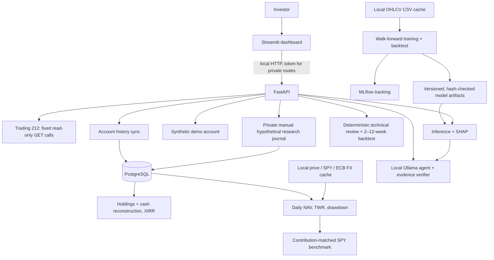

# MarketOps architecture

Layers: `src/marketops/` holds pure domain code (valuation, performance, ML, agent, broker adapter),
`api/` the FastAPI routes and the single authentication dependency, `app/` the Streamlit dashboard
(`perf_view.py` is formatting and charts only). Valuation, comparison and benchmark simulation are pure
functions over rows and cached files, so they are tested without network or database.

Design constraints: no code path for trades or transfers; read-only broker keys; private routes need a
local token and deny by default; no user position data in logs; fetched market data is cached
locally and never committed; no claim of ML performance without out-of-sample evaluation; a figure is
refused rather than estimated when its inputs do not reconcile.
