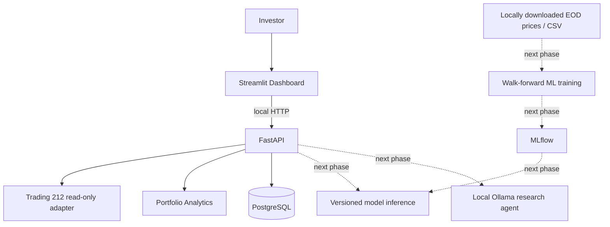

# MarketOps Architecture

Design constraints: no trade execution capability; authenticated local keys with read-only permissions;
no user position data in logs; no fetched market data redistributed; no claims of ML performance without
real out-of-sample evaluation. PostgreSQL foundation is ready but the portfolio API currently remains
stateless and does not persist broker records.
